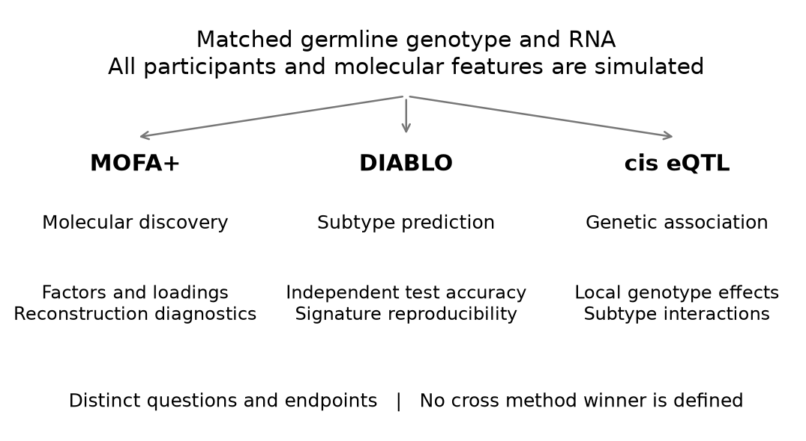
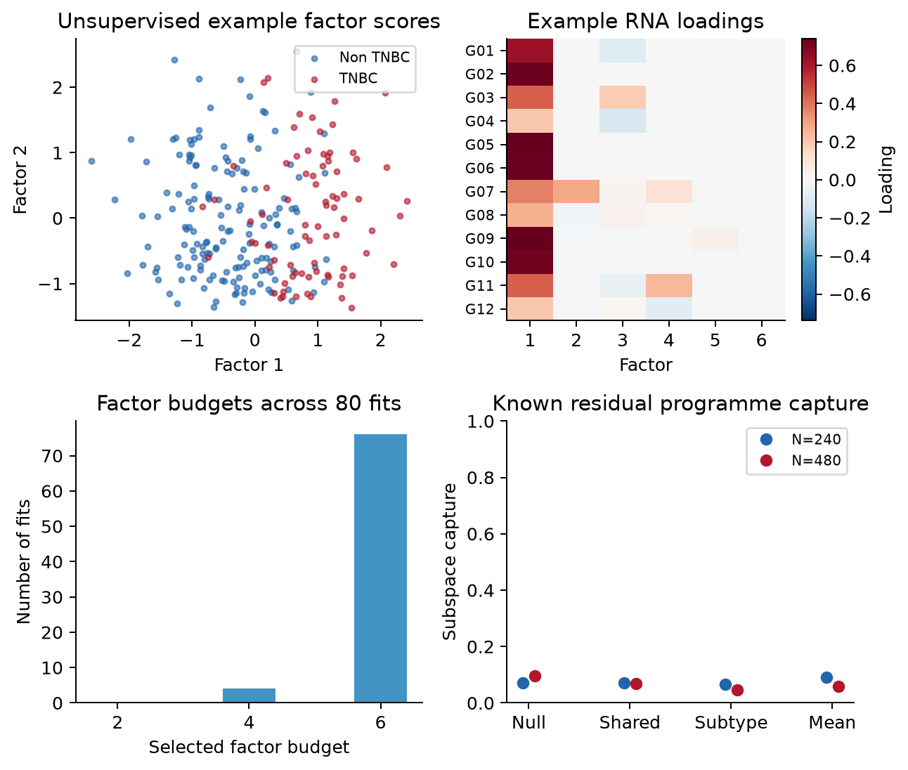
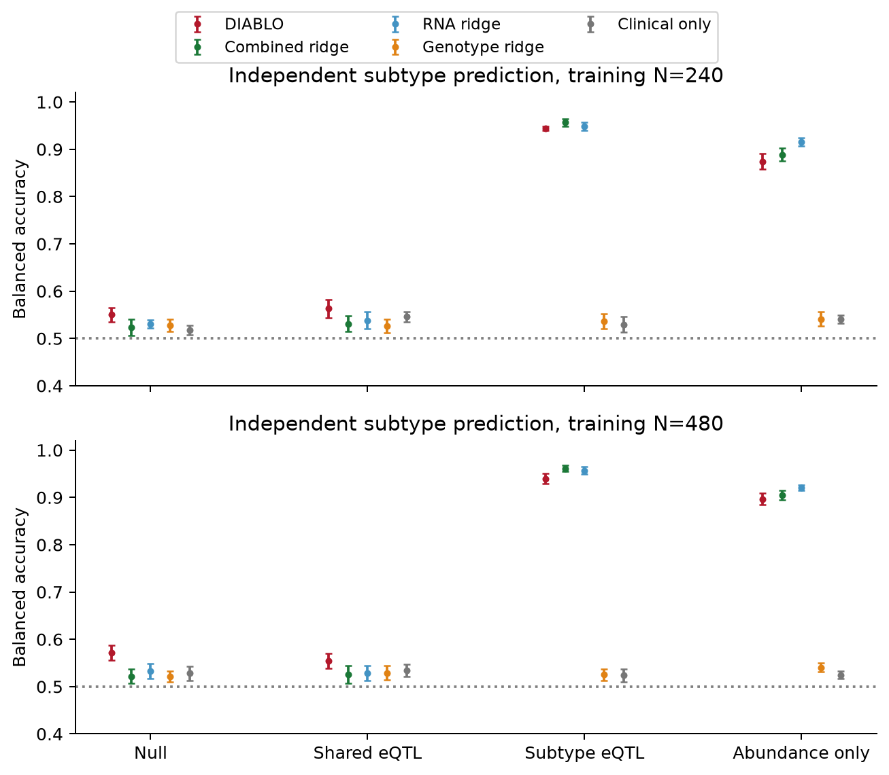
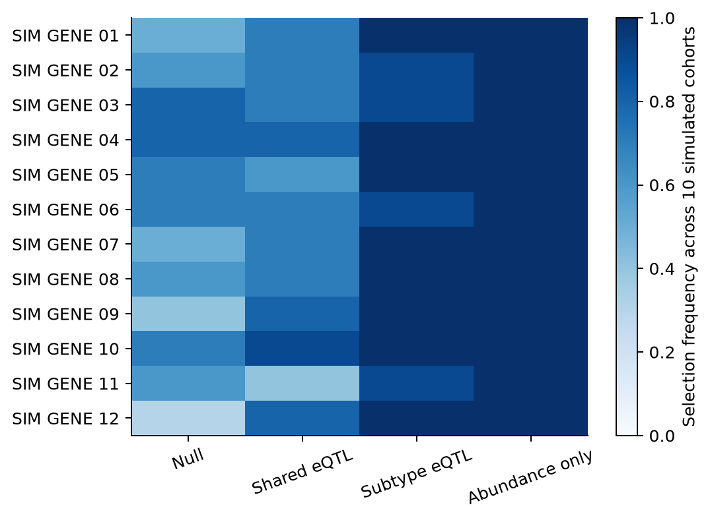
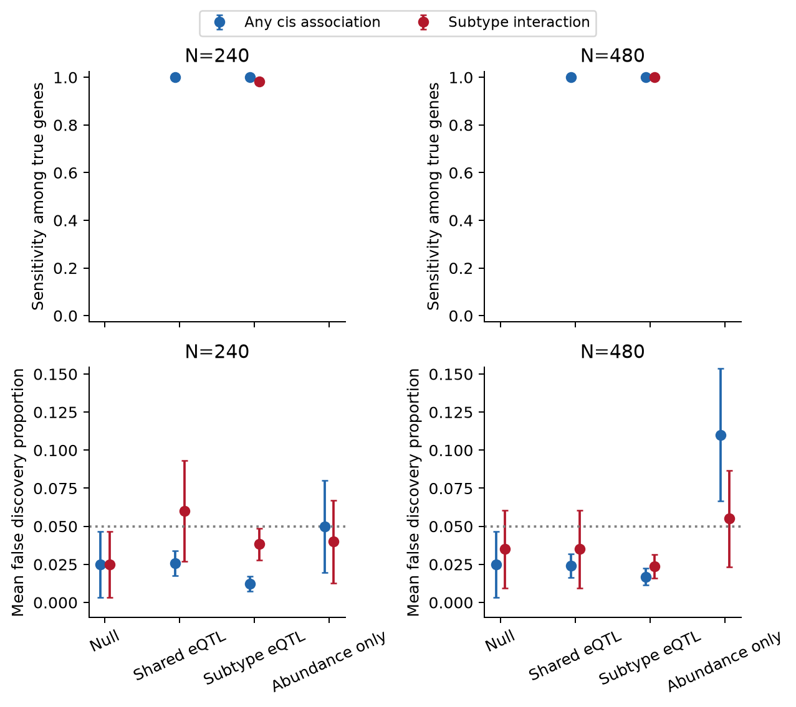
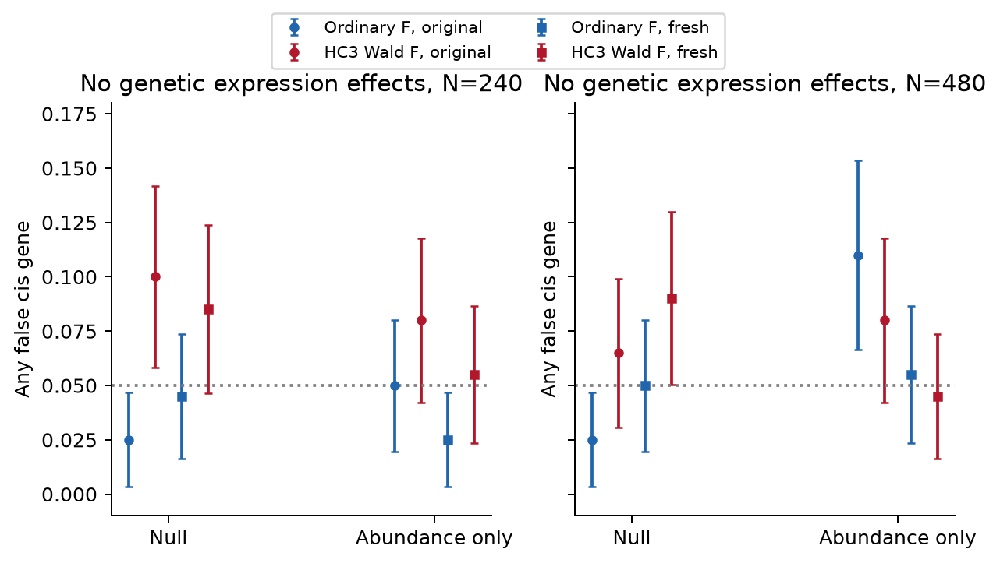
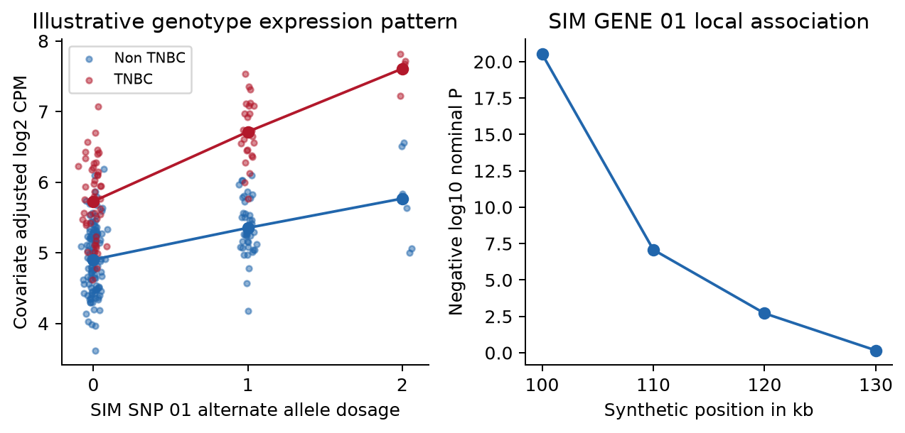
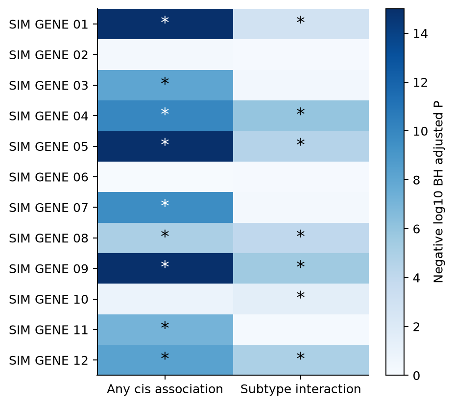

**Simulation study.** All participants, genomic positions, LD, gene identifiers, RNA counts and TNBC labels are synthetic. The two molecular layers are germline genotype and RNA. No real patient material, breast cancer eQTL discoveries, protein or somatic assay layer is included. This is an illustrative design for Study 3, not a clinical or causal validation study.

## Abstract

We organised genotype and RNA analyses of simulated breast cancer cases around three complementary questions. MOFA+ described unsupervised molecular variation; DIABLO evaluated supervised TNBC versus non-TNBC signatures; and cis-eQTL models tested local genotype–expression associations and subtype interactions. The preserved simulation comprised 1,600 eQTL cohorts, 80 independent training/test pairs and 800 additional fresh negative-control cohorts at training sizes of 240 and 480. New post hoc summaries describe existing MOFA representations and DIABLO feature-selection reproducibility without refitting or changing the underlying simulations. In the subtype-eQTL scenario at N = 480, DIABLO balanced accuracy was 0.940, compared with 0.961 for a combined ridge reference and 0.957 for RNA ridge. These predictive results do not rank MOFA as a discovery method. The eQTL negative controls showed error excesses for ordinary F and HC3 references in some cells. The workflow illustrates how the three analyses can inform different aspects of Study 3 while retaining uncertainty, simple baselines and the need for further calibration and independent biological validation.

## Introduction

Matched germline genotype and RNA measurements can support several scientific questions in breast cancer cases. One concerns the major programmes of molecular variation; another concerns a reproducible signature of subtype; a third concerns genetic associations with expression. These questions overlap biologically but require different statistical objectives and evidence.

MOFA+ learns latent factors without using subtype labels during representation fitting [1,2]. DIABLO uses those labels to learn a multiblock signature [3,4]. A regional eQTL model tests genotype–expression associations rather than molecular clustering or classification [5,6]. The present study therefore does not define a MOFA+ versus DIABLO winner. Each method is interpreted against its intended question.

The study uses blood-like bulk RNA, idealised covariates and case-only TNBC labels. Synthetic genes deliberately avoid assigning invented associations to real breast cancer genes. No patient cohort, tissue-specific public eQTL dataset or actual breast cancer GWAS was analysed. The aim is to make a possible Study 3 analysis inspectable before real assay, cohort and validation requirements are finalised.

## Methods

### Three questions and their endpoints

Table 1 separates the objectives. MOFA discovery is not judged by DIABLO classification accuracy; DIABLO prediction is assessed against simpler prediction workflows; eQTL inference retains its own hypotheses and negative controls.

| Analysis | Question | Evidence | Interpretive boundary |
| --- | --- | --- | --- |
| MOFA+ | Discover molecular variation | Factors, loadings and reconstruction | Subtype accuracy does not define discovery success |
| DIABLO | Develop a supervised subtype signature | Independent prediction and feature reproducibility | A predictive feature is not necessarily an eQTL |
| cis eQTL | Test local genetic expression associations | Association, interaction and error control | Association does not establish causal mediation |

{fig-alt="Three complementary analyses using the same molecular layers" width=6.4in}

Figure 1. Parallel analyses of genotype and RNA with distinct endpoints. The arrows indicate data inputs, not an established causal chain or a competition between methods.

### Simulation design and provenance

The two molecular panels contain 24 germline dosages across six synthetic local LD regions and 12 RNA genes. Four scenarios separate a molecular null, shared eQTLs, subtype-dependent eQTLs with abundance shifts, and abundance shifts without eQTLs. Sample sizes are 240 and 480. The eQTL experiment uses 200 cohorts per scenario and size; the integration experiment uses ten independently generated training cohorts per cell with 360 independent test cases each.

All original fitted-model, eQTL and robustness records are preserved byte for byte in this standalone repository. Numerical provenance identifies the source repository and commit. The scientific models were frozen before the original evaluation. Standalone packaging changes only file paths in the R scripts. The complementary framing, programme diagnostics and selection-frequency summaries were developed after the simulations; they are descriptive post hoc analyses, not newly preregistered endpoints. No effect sizes, seeds, model choices or test participants were selected or changed to support the reframing.

### Synthetic participants and local genetic structure

Each cohort represented breast cancer cases with a simulated TNBC indicator. Age, cellular composition, three ancestry strata and three batches were generated independently at the participant level except for prespecified ancestry-dependent allele frequencies. Each of six local regions contained four correlated variants. Latent Gaussian correlation between variants a and b was $0.65^{|a-b|}$; inverse-binomial thresholds generated 0, 1 or 2 alternate allele dosages. Allele frequencies varied approximately between 0.18 and 0.40 before modest ancestry shifts. This supplies synthetic LD, not an empirical African or other population reference.

Subtype sampling followed

$$
\Pr(T_i=1\mid G_i,C_i)=\operatorname{expit}\{-0.65+0.30A_i+0.25F_i+0.20I(S_i=2)+0.25(G_{i1}-2p_1)\},
$$

where A is standardised age, F is standardised cell fraction, S is synthetic ancestry and T denotes TNBC. The model defines a case-only subtype contrast. It does not compare cases with healthy controls or estimate genetic susceptibility to breast cancer.

### RNA abundance and known eQTL truth

Two genes were assigned to each synthetic region. Their RNA abundance depended on clinical and technical covariates, three shared residual programmes and gene-specific noise. The latent log2 abundance was

$$
L_{ig}=5+C_i^\top\eta+H_i^\top w_g+\beta_gG_{iv(g)}+\gamma_gT_i+\delta_gG_{iv(g)}T_i+\epsilon_{ig},
$$

with $H_i\sim N_3(0,I)$, one loading of 0.25 per gene and $\epsilon_{ig}\sim N(0,0.35^2)$. Each gene had a prespecified local causal variant. In shared-eQTL settings, six genes had $\beta_g=0.45$. In subtype-eQTL settings, six genes additionally had positive or negative $\delta_g=0.65$ in magnitude, giving nine genes with any genetic effect. Six genes also had subtype abundance shifts of 0.65. The abundance-only setting retained those mean shifts with all genetic expression effects zero. The null setting had neither genetic expression effects nor direct subtype abundance shifts; subtype still depended on the stated clinical and genotype inputs.

Counts were generated using the known simulated whole-assay library size $s_i$:

$$
K_{ig}\sim\operatorname{NB}(\mu_{ig},r=30),\quad \mu_{ig}=\frac{s_i}{10^6}2^{L_{ig}},\quad \operatorname{Var}(K_{ig}\mid L,s)=\mu_{ig}+\frac{\mu_{ig}^2}{30},
$$

$$
Y_{ig}=\log_2\left(10^6K_{ig}/s_i+1\right).
$$

These are small selected RNA panels, not simulated complete transcriptomes. Known whole-assay libraries avoid incorrectly normalising by the sum of only twelve genes. Linear eQTL models were fitted to Y; the log transformation and count noise make their coefficients working observed-expression effects rather than exact estimates of every latent L coefficient.

### Quality checks

The workflow checks allele dosage validity, finite measurements, count integrality, positive library sizes, sample alignment and gene/variant dimensions. The released example includes explicit sample identifiers, covariates, library sizes, a variant map and a separate simulation truth table. These are analysis-ready synthetic matrices; FASTQ alignment, variant calling and imputation were not performed.

Minor allele frequencies and within-ancestry Hardy–Weinberg summaries are descriptive. The Pearson approximation is reported only where all expected genotype counts are at least five. Small ancestry strata are flagged where that approximation is unsuitable; phenotype-dependent genotype filtering is not applied. Relatedness, sample swaps, real genotype uncertainty and sequencing artefacts require additional QC in the actual study.

### Analysis 1 Molecular discovery with MOFA

The official mofapy2 engine fitted genotype and RNA views using Gaussian working likelihoods after training-only ancestry and batch adjustment and view standardisation. Gaussian dosage treatment is an approximation, not a binomial genotype likelihood. Subtype labels were excluded from preprocessing and factor fitting.

For each view m,

$$
X^{(m)}=ZW^{(m)\top}+E^{(m)}.
$$

Factor budgets 2, 4 and 6 were selected by 15% masked training entries in both views, with equal weight for the standardised view errors. Masked entries were excluded from preprocessing fits. A PCA start and a genuinely distinct perturbed-PCA start were selected by training ELBO. The selected model was refitted to the complete training views. Factor-budget counts and masked reconstruction are reported for all 80 fits. Selected validation errors are selection diagnostics, not independent-test reconstruction estimates.

Descriptive programme diagnostics use the eight already-saved first-replicate fixtures, one per scenario and sample size. The training projection reconstruction was summarised by

$$
R_m^2=1-\frac{\|X^{(m)}-\widehat ZW^{(m)\top}\|_F^2}{\|X^{(m)}-\overline X^{(m)}\|_F^2}.
$$

This uses plug-in Gaussian posterior-mean projections and is not the official MOFA posterior variance-decomposition output. It is a training reconstruction diagnostic; negative values are possible. Loadings and score plots describe the fitted representation without assigning real pathway names.

Capture of the three known residual programmes used centred orthonormal bases:

$$
S=\frac{\|Q_Z^\top Q_H\|_F^2}{3}.
$$

This quantity is invariant to sign changes and rotations. It measures only the planted residual H subspace, not every genetic, subtype or clinical contribution that MOFA may legitimately represent. It therefore cannot define total discovery success.

As an additional post hoc diagnostic, complete RNA was withheld for independent test cases. Fixed genotype loadings and precisions supplied genotype-only score projections:

$$
\widehat z_i^{(G)}=(I+W_G^\top\Lambda_GW_G)^{-1}W_G^\top\Lambda_Gx_i^{(G)},\qquad
\widehat x_i^{(R)}=W_R\widehat z_i^{(G)}.
$$

RNA error was compared with a training-mean baseline on the same standardised scale. These eight fixture-level results are supplied in the [discovery diagnostics table](https://github.com/Vusumuzi2Mabasa/Breast-Cancer-Genotype-RNA-eQTL/blob/main/results/mofa_discovery_examples.csv), without a claim to 80-replicate precision. Bootstrap factor stability, pathway enrichment and biological replication were not assessed.

### Analysis 2 Subtype signatures with DIABLO

Official R mixOmics DIABLO used genotype and RNA molecular blocks plus the same observed clinical information available to the prediction references. The clinical-input block is not an additional molecular assay. Threefold stratified training-only validation selected one or two components and four or eight features per block, bounded by available features. Preprocessing was repeated within each fold.

Weighted centroid voting produced subtype classes. Independent-test balanced accuracy was

$$
\mathrm{BA}=\frac{1}{2}\left\{\frac{\mathrm{TP}}{\mathrm{TP}+\mathrm{FN}}+
\frac{\mathrm{TN}}{\mathrm{TN}+\mathrm{FP}}\right\}.
$$

The relevant references are combined genotype/RNA ridge, RNA ridge, genotype ridge and clinical-only ridge classifiers, each with fixed C = 1, training-only scaling and the same independent test participants. Their fixed 0.5 probability threshold differs from DIABLO voting; results concern complete predictive workflows. Hard DIABLO labels were not treated as calibrated probabilities or used to create artificial ROC curves.

Molecular feature selection frequency was the proportion of ten independent simulation replicates in a cell in which a feature had a non-zero loading on any selected DIABLO component. It describes reproducibility across generated cohorts, not a bootstrap stability estimate for the same patients. The supervised response block was excluded from the feature summary. Constant-feature handling was checked before mapping feature indices back to original synthetic identifiers.

Previously computed MOFA and PCA classifier outputs remain in the inherited numerical records for provenance. They are not used as primary MOFA discovery endpoints or to rank MOFA against DIABLO in this report.

### Analysis 3 Local genotype expression associations

For each gene, the four variants in its local synthetic region were modelled jointly:

$$
Y_{ig}=\alpha_g+C_i^\top\theta_g+\tau_gT_i+\sum_{v\in\mathcal C_g}b_{gv}G_{iv}+\sum_{v\in\mathcal C_g}d_{gv}G_{iv}T_i+e_{ig}.
$$

Age, cellular composition, known ancestry and batch were included as covariates. Molecular factors learned from the same expression matrix were not automatically included, since they could absorb the genetic signal of interest. The primary omnibus test compared this full model with a model containing only the covariates and subtype:

$$
H_{0g}^{\mathrm{cis}}:\quad b_{gv}=d_{gv}=0\quad\text{for every }v\in\mathcal C_g.
$$

The separate interaction test compared the full model with one retaining common genotype effects but omitting interactions:

$$
H_{0g}^{\mathrm{interaction}}:\quad d_{gv}=0\quad\text{for every }v\in\mathcal C_g.
$$

Nested-model F statistics used the observed design ranks:

$$
F_g=\frac{(\mathrm{RSS}_0-\mathrm{RSS}_1)/(r_1-r_0)}{\mathrm{RSS}_1/(n-r_1)}.
$$

The nominal F reference assumes a correctly specified Gaussian linear model with homoscedastic errors. Count transformation makes this a working approximation; its realised error rates were assessed through the repeated null and abundance-only simulations rather than asserted to be exact. Genotype by subtype interaction tests assess differences directly; significance in one subtype and non-significance in another is not such a test.

Benjamini–Hochberg adjustment was applied separately to twelve gene-level omnibus P values and twelve interaction P values within each cohort. For ordered P values, the adjusted values were

$$
q_{(j)}=\min\left\{1,\min_{k\ge j}\frac{12p_{(k)}}{k}\right\}.
$$

The two families were not jointly controlled. Dependence assumptions and model approximation remain relevant, so empirical mean false discovery proportions are reported. Sensitivity used the known gene-level truth. An LD-correlated tag association was not called a false causal discovery: these tests identify a gene-level regional association, not the causal nucleotide. No fine-mapping, colocalisation, mediation or pQTL analysis was performed.

### Variance robustness and fresh negative controls

The original abundance-only N = 480 omnibus cell showed realised FDR of 0.110. After observing this result, an explicit protocol amendment added HC3 covariance estimates on the unchanged gene models and 800 fresh null/abundance-only cohorts, 200 per scenario and sample size. The sensitivity implementation and new seed bank were frozen before those fresh cohorts were evaluated. No original effect sizes, seeds, thresholds or results were replaced.

For design matrix X, residuals e and leverage h, HC3 used

$$
\widehat V_{\mathrm{HC3}}=(X^\top X)^{-1}X^\top\operatorname{diag}\left\{\frac{e_i^2}{(1-h_i)^2}\right\}X(X^\top X)^{-1}.
$$

For the q tested coefficients, the Wald quantity divided by q was compared with an approximate F distribution using q and n minus the design rank degrees of freedom. BH was applied separately within the same twelve-gene families. This is a variance-robust sensitivity analysis, not exact finite-sample calibration or a correction for every possible mean-model error.

### Uncertainty and validation

Predictive means and approximate 95% Monte Carlo intervals use ten independent replicates per scenario and sample size. eQTL summaries use 200 cohorts per cell. These are simulation comparisons, not clinical confidence intervals or biological replication.

The original six model unit tests, complete integration replay, eight eQTL cohort replays, independent R test-statistic checks and probability/voted-class metric checks are retained. New validation checks orthonormal-subspace capture, fixed-model reconstruction arithmetic and the separation of discovery and supervised endpoints. The preservation manifest verifies all original fitted-model and eQTL records. Document pages are rendered and visually reviewed before publication.

## Results

### Analysis 1 Molecular representations and programme diagnostics

MOFA supplied an unsupervised representation rather than a subtype classifier ranking. Table 2 reports factor selection and reconstruction diagnostics at N = 480. Its selected budget and masked MSE summarise ten fits per cell; projection R2 and residual-programme capture describe only the fixed first-replicate fixture. Those scopes should not be combined into a fictitious repeated estimate.

Table 2. MOFA discovery diagnostics at N = 480. Training projection R2 and capture are descriptive fixture values, not posterior variance decomposition or clinical validation.

| Scenario | Median K | Masked MSE | Genotype R2 | RNA R2 | Residual capture |
| --- | --- | --- | --- | --- | --- |
| Null | 6.0 | 0.815 | 0.434 | 0.316 | 0.096 |
| Shared eQTL | 6.0 | 0.800 | 0.417 | 0.358 | 0.069 |
| Subtype eQTL | 6.0 | 0.795 | 0.421 | 0.362 | 0.045 |
| Abundance only | 6.0 | 0.772 | 0.415 | 0.394 | 0.059 |

The upper factor budget of six was selected in 76 of 80 fits. This boundary selection limits conclusions about an adequate factor dimension; larger budgets were not evaluated in this reframing. The score and loading plots show how the model distributes variation among factors and molecular features. Subtype colours were added after unsupervised fitting. Apparent separation or overlap is descriptive; it is not the objective used to select the factor representation. The weak planted residual programmes are only one component of total molecular variation, so their capture should be interpreted alongside reconstruction and genetic structure.

{fig-alt="Unsupervised factors loadings and discovery diagnostics" width=6.4in}

Figure 2. MOFA scores and RNA loadings for the prespecified 240-case example, factor-budget counts across 80 fits and residual-programme capture in eight first-replicate fixtures. Capture points have no repeated-fit confidence intervals. Synthetic gene labels do not identify actual pathways.

### Analysis 2 Independent prediction and signature reproducibility

Table 3 evaluates DIABLO against prediction references. In the subtype-eQTL scenario, RNA-only and combined ridge performance show that much of the discriminating information is already available in RNA abundance. High accuracy does not establish that integration was necessary, that a selected feature is genetically regulated, or that the signature will transfer to clinical data. No MOFA discovery ranking follows from these results.

Table 3. Mean independent-test balanced accuracy at training N = 480 across ten simulation replicates.

| Scenario | DIABLO | Combined ridge | RNA ridge | Genotype ridge | Clinical only |
| --- | --- | --- | --- | --- | --- |
| Null | 0.572 | 0.522 | 0.533 | 0.521 | 0.528 |
| Shared eQTL | 0.555 | 0.525 | 0.529 | 0.529 | 0.534 |
| Subtype eQTL | 0.940 | 0.961 | 0.957 | 0.525 | 0.524 |
| Abundance only | 0.897 | 0.905 | 0.920 | 0.541 | 0.525 |

{fig-alt="Independent DIABLO prediction against simple references" width=6.4in}

Figure 3. Balanced accuracy with approximate 95% Monte Carlo intervals across ten independently generated training/test pairs per cell. MOFA classification is not part of this supervised benchmark. The dotted line is 0.5.

Feature-selection frequencies describe which RNA measurements repeatedly entered supervised signatures. Reproducible selection in these synthetic cohorts is useful as a workflow diagnostic, but it does not supply biological annotation or establish a regulatory mechanism. Ten replicates give frequencies only in increments of 0.1. In the N = 480 subtype-eQTL and abundance-only scenarios, the union across fitted components selected all twelve RNA genes in every replicate. This reflects limited selectivity in a small panel: a feature selected everywhere is not thereby established as a specific biomarker. Coefficient-direction stability was not assessed.

{fig-alt="RNA selection frequency in DIABLO signatures" width=6.4in}

Figure 4. Proportion of ten independent N = 480 cohorts selecting each RNA feature on at least one fitted DIABLO component. This is simulation reproducibility, not a bootstrap estimate or external biomarker replication. Genotype feature frequencies are also released in the numerical table.

### Analysis 3 Cis associations and subtype interactions

Shared-eQTL cohorts contained six true cis-associated genes and no true interactions. Subtype-eQTL cohorts contained nine cis-associated genes and six interaction genes. Null and abundance-only cohorts contained no true genetic expression effects. Genetic mapping was evaluated against those planted truths independently of the classifier results.

Table 4. Gene-level sensitivity and realised mean false discovery proportion at N = 480 across 200 cohorts per scenario. Sensitivity is undefined where no true alternatives exist.

| Scenario | Test family | Sensitivity | Mean FDP | Mean discoveries |
| --- | --- | --- | --- | --- |
| Null | Any cis association | Not applicable | 0.025 | 0.03 |
| Null | Subtype interaction | Not applicable | 0.035 | 0.04 |
| Shared eQTL | Any cis association | 1.000 | 0.024 | 6.17 |
| Shared eQTL | Subtype interaction | Not applicable | 0.035 | 0.04 |
| Subtype eQTL | Any cis association | 1.000 | 0.017 | 9.17 |
| Subtype eQTL | Subtype interaction | 1.000 | 0.024 | 6.17 |
| Abundance only | Any cis association | Not applicable | 0.110 | 0.13 |
| Abundance only | Subtype interaction | Not applicable | 0.055 | 0.07 |

{fig-alt="Genetic association detection and false discoveries" width=6.4in}

Figure 5. Omnibus cis and subtype-interaction detection and error rates, with approximate 95% Monte Carlo intervals. Missing sensitivity points indicate settings without true alternatives. Strong planted effects and only twelve gene tests make these power estimates unsuitable for extrapolation to a transcriptome-wide clinical study.

The negative controls remain a substantive limitation. Ordinary F tests selected null genes in 11% of the original abundance-only N = 480 cohorts; HC3 reduced that point estimate to 8%. Fresh abundance-only values were 5.5% and 4.5%, respectively. HC3 also produced elevated complete-null rejection in other cells, including 8.5% at N = 240 and 9% at N = 480 in the fresh bank. Neither reference is certified for confirmatory eQTL use without further calibration.

Table 5. Original and fresh abundance-only negative controls at N = 480. All genes are null for genetic expression effects, so mean FDP equals the probability of selecting any gene.

| Bank | Reference | Any cis gene | Any interaction gene |
| --- | --- | --- | --- |
| original | Ordinary F | 0.110 | 0.055 |
| original | HC3 Wald F | 0.080 | 0.040 |
| fresh | Ordinary F | 0.055 | 0.050 |
| fresh | HC3 Wald F | 0.045 | 0.045 |

{fig-alt="Original and fresh eQTL negative controls" width=6.4in}

Figure 6. Ordinary F and HC3 negative-control behaviour in original and fresh cohorts. Circles and squares distinguish the two banks. The original elevated rates are preserved; fresh results do not erase them or prove general calibration.

### A prespecified illustrative locus

The example dataset contains 240 simulated cases, including 79 TNBC cases and 161 non-TNBC cases. Its call rate is 100%, all 24 variants have valid dosage values, all twelve RNA measurements are finite, and the minimum observed minor allele frequency is 0.142. These properties reflect the idealised generator and do not replace real genotype or RNA-seq QC.

The first locus illustrates a deliberately planted subtype-dependent genotype–expression relationship. The local plot contains four synthetic variants and is not a genome-wide Manhattan plot. Correlated tag associations do not identify a causal nucleotide. This locus was fixed before evaluation rather than selected for an attractive signal.

{fig-alt="Prespecified genotype expression relationship" width=6.4in}

Figure 7. Covariate-adjusted example expression by genotype dosage and subtype, and nominal local tag-association P values. SIM SNP 01 and SIM GENE 01 are invented identifiers; these are not findings about an actual breast cancer gene.

Table 6 retains every gene in the example, including non-significant genes and false discoveries. In particular, a significant interaction for a gene with a false truth label must not be reinterpreted as biological evidence.

Table 6. Original ordinary-F BH-adjusted P values and known simulation truth in the fixed example. Negative-control limitations apply.

| Synthetic gene | Cis q | Interaction q | True cis effect | True interaction |
| --- | --- | --- | --- | --- |
| SIM GENE 01 | 2.31e-19 | 0.00145 | Yes | Yes |
| SIM GENE 02 | 0.521 | 0.719 | No | No |
| SIM GENE 03 | 8.77e-09 | 0.431 | Yes | No |
| SIM GENE 04 | 1.08e-10 | 1.15e-06 | Yes | Yes |
| SIM GENE 05 | 5.7e-18 | 3.03e-05 | Yes | Yes |
| SIM GENE 06 | 0.863 | 0.719 | No | No |
| SIM GENE 07 | 2.26e-10 | 0.509 | Yes | No |
| SIM GENE 08 | 9.38e-06 | 9.32e-05 | Yes | Yes |
| SIM GENE 09 | 1.08e-18 | 3.09e-06 | Yes | Yes |
| SIM GENE 10 | 0.126 | 0.0318 | No | No |
| SIM GENE 11 | 7.95e-08 | 0.656 | Yes | No |
| SIM GENE 12 | 5.02e-09 | 1.07e-05 | Yes | Yes |

{fig-alt="Example association map with separate gene families" width=6.4in}

Figure 8. Omnibus and interaction q values for all twelve example genes; asterisks mark q below 0.05 within each separately adjusted family. Negative log10 q colours are capped at 15. This statistical map does not establish causal regulation.

## Discussion

The three analyses can inform different parts of Study 3 without competing for a single accuracy ranking. MOFA factors can generate hypotheses about molecular programmes and heterogeneity. DIABLO can test whether a supervised signature predicts subtype beyond simple references. eQTL models can identify candidate genotype–expression associations and possible subtype-dependent effects. A useful signature need not contain eQTL genes, and a shared eQTL need not distinguish subtypes.

The present discovery summaries are limited. MOFA is not guaranteed to recover weak residual programmes when substantial genotype, abundance and covariate variation is also present. The new reconstruction and capture diagnostics describe eight stored fixtures and are post hoc. Factor stability, actual pathway enrichment and independent programme replication remain unmeasured. A biological interpretation of real factors requires assay-aware annotation and validation rather than naming synthetic loadings as pathways.

DIABLO benefited from strong planted RNA abundance differences, and simpler RNA and combined ridge references performed well. The subtype-eQTL scenario also changes abundance, so its prediction results do not isolate the contribution of genetic interactions. Signature selection frequency across ten synthetic cohorts is an initial reproducibility check, not evidence of a clinically stable panel.

The eQTL analysis has a different weakness: some negative-control error rates exceed the nominal level. Robust covariance estimates do not solve every mean-model problem or finite-sample distortion. Further calibration, covariate sensitivity and larger fresh null banks are needed before confirmatory use. The small gene panel, common variants, synthetic LD and strong effects do not yield a definitive PhD power calculation.

All measurements are blood-like and synthetic. Real Study 3 work must address ancestry, relatedness, genotype uncertainty, expression QC, cell-composition estimation, clinical timing, case selection and independent replication. Blood associations do not establish tumour origin. Genetic association does not establish a causal allele, RNA mediation or breast cancer susceptibility. Fine-mapping, colocalisation with real GWAS and causal mediation require their own data and assumptions; they were not performed here.

## Conclusion

A genotype-and-RNA study can combine unsupervised molecular discovery, supervised subtype signatures and local genetic association mapping as complementary analyses. The current simulation illustrates that structure with preserved numerical results, purpose-specific figures and explicit limits. It does not define a MOFA+ versus DIABLO winner, identify real breast cancer eQTLs or provide a clinically validated biomarker.

## References

1. Argelaguet R, et al. MOFA+: a statistical framework for comprehensive integration of multi-modal single-cell data. Genome Biology. 2020;21:111. [Methods paper](https://doi.org/10.1186/s13059-020-02015-1).
2. MOFA developers. [Official preprocessing and interpretation guidance](https://biofam.github.io/MOFA2/faq.html).
3. Singh A, et al. DIABLO: an integrative approach for identifying key molecular drivers from multi-omics assays. Bioinformatics. 2019;35:3055–3062. [Methods paper](https://doi.org/10.1093/bioinformatics/bty1054).
4. mixOmics developers. [Official DIABLO documentation](https://mixomics.org/mixdiablo/).
5. GTEx Consortium. The GTEx Consortium atlas of genetic regulatory effects across human tissues. Science. 2020;369:1318–1330. [Research article](https://pmc.ncbi.nlm.nih.gov/articles/PMC7737656/).
6. EMBL-EBI. [eQTL Catalogue](https://www.ebi.ac.uk/eqtl/).

## Data and code availability

All observations and genomic annotations in this study are synthetic. No patient records, private proposal documents or controlled-access data are included. The standalone study is available in [Breast Cancer Genotype RNA eQTL](https://github.com/Vusumuzi2Mabasa/Breast-Cancer-Genotype-RNA-eQTL) under the MIT licence. The [original repository](https://github.com/Vusumuzi2Mabasa/Breast-Multiomics-Copula-MOFA/tree/f3a2041) remains preserved.
